# 全国空气质量实时监测看板 · v69

双击 `index.html` 打开。改过东西后按 **Ctrl + F5** 强刷。

> **v26 核心变化：三个视图合并成一个**，靠缩放连续下钻，不再有「全国总览 / 区县分布 / 3D 城市」的页签。

---

## 一、一条缩放线走到底

```
全国（省份一览）
   ↓ 点省份 / 滚轮放大
省内城市（城市一览）
   ↓ 点城市 / 搜城市
区县区块（在地图上画真实边界）
   ↓ 继续放大到 z ≥ 12.4（自动）
3D 城市（区县挤出 + 建筑体块，可继续放大看楼高）
   ↓ 缩小到 z < 11.6
自动退回地图
```

- **顶部面包屑**：`全国 › 河南 › 郑州`，点哪级回哪级，「返回上一级」逐级退出
- 左侧列表、右侧指标随层级自动切换统计口径（省份 / 城市 / 区县）
- 全程只有**一张高德地图**，缩放、拖拽、双击都在同一张图上

## 二、三级联动：省 → 市 → 区县

| 层级 | 数据来源 | 交互 |
|---|---|---|
| 省份一览（31 个） | 83 城按省聚合（平均值、城市数、最脏城市） | 点省 → 飞到该省 |
| 城市一览 | 该省下的城市 | 点市 → 画出区县 |
| 区县一览 | **本地边界缓存**（35 市 / 404 个区县） | 点区县 → 高亮 AQI |

## 三、城市数量从 11 个扩到 35 个

新增采集 24 个市的区县边界，并做 **RDP 多边形简化**：

- 原始 9.58 MB → **1.37 MB**（保留 14% 的点，误差约 100 m）
- 覆盖：郑州/广州/深圳/成都/杭州/武汉/南京/苏州/青岛/长沙/沈阳/合肥/福州/厦门/济南/大连/昆明/贵阳/南宁/太原/石家庄/哈尔滨/长春/南昌/兰州/乌鲁木齐/呼和浩特/宁波/无锡/佛山/东莞/温州/常州/徐州/烟台
- 共 **404 个区县**，全部秒开、可进 3D

## 四、3D 城市能"看到楼"

在区县层级继续放大（z ≥ 12.4）自动切到 Three.js：

- 区县多边形按 AQI **挤出**成基座（底 #1B66A0 → 顶 #2BB692 渐变 + 菲涅尔 + 发光描边）
- 基座上按网格**撒出建筑体块**（本次 483 栋），高度 2~7 随机但跟着 AQI 走，**能看出高低错落**
- 8s 一轮自下而上扫描（扫中 ×1.4 提亮）
- 流动 UV 飞线、UnrealBloom 泛光、CatmullRom 巡航、2.4s 扩散环、雷达扇
- 点区块 → 相机飞到该区县，右侧显示 AQI 与高度说明

## 五、面板不再挡地图

- 右下角新增 **◧ 按钮**（或按 `P` 键）一键收起左右面板，地图全屏可操作
- 面板是磨砂玻璃（`rgba(3,11,20,.78)` + `blur(14px)`），透出底图
- 搜索、面包屑、污染物标签、图例都是独立浮层

## 六、之前修好的（保留）

- **滚轮缩放**：`#baseMap` 的 `pointer-events` 修复 + 资源版本号统一（旧 CSS 被缓存导致点不到地图）
- **城市搜索**：输入精确城市名自动飞过去，`↑↓` + 回车可选，支持搜省份
- 抓取实时数据（Open-Meteo 83 城）、导入/导出 Excel、AI 问答、四个图表、双榜、明细表
- 精确居中缩放，任何窗口不裁切

## 使用

```bash
cd aq-board
python -m http.server 8000
# http://localhost:8000/
```

直达参数：`?city=南京` 直接下钻到南京。

## 已知限制

1. 区县 / 街道 AQI 是派生值（城市实测值 + 名称哈希）。
2. 直辖市（北京/上海/天津/重庆）高德只返回 1 条下级，暂不支持区县与 3D。
3. 3D 里的"楼"是按区块网格生成的示意体块（没有逐栋建筑数据）；要真实楼栋需 OSM buildings（我这边 Overpass 超时，未接入）。
4. 高德 `© AutoNavi` 水印必须保留。

## 文件

```
aq-board/
├── index.html
├── css/v9.css
├── js/config.js          高德 Key
├── js/data.js            AQI + Open-Meteo + Excel
├── js/app9.js            看板渲染层
├── js/basemap.js         高德底图 + 光弧
├── js/drill.js           ★ 单视图连续下钻（省→市→区县→3D）
├── js/city3d.js          ★ Three.js 3D 城市（挤出 + 建筑体块）
├── js/ai.js              AI 问答
├── assets/districts.js   35 市 / 404 区县边界（1.37 MB）
├── assets/three/         three.js + 后期处理
└── assets/               echarts / 中国省界 / xlsx
```

---

## v26.1 修复：底部仪表盘/图表/明细表不见了

合并三视图那一版，替换面包屑时**多留了一个 `</div>`**，把 `#cascadeView` 提前闭合，
导致 `.chart-row`、`.hud-bottom` 被挤到 `.grid` 外面（挂在 DOM 树上但不在网格里，所以看不见）。

已修正标签闭合，底部四块回来了：

- 10 **AQI 仪表盘**（该城市 / 全国）
- 11 **等级数量分布**（环形）
- 12 **污染物平均浓度**（柱状）
- 13 **24H 浓度趋势**（折线）
- 14 **各城市检测明细**（可搜索 / 排序）

实测：`.grid` 子元素恢复为 5 个（header / KPI / main-row / chart-row / footer），
四个图表 canvas 均已渲染，明细表 83 行。

---

## v27：按《分析_SmartCity 与持续放大》复刻的 3D 观感

读了那份 Cesium 包拆解，把它的五层效果搬到了 `city3d.js`（three.js），不依赖 Ion token / LFS 素材：

| 参考里的做法 | 本项目实现 |
|---|---|
| `CustomShader` REPLACE_MATERIAL + UNLIT，完全丢掉 PBR | 自写 `ShaderMaterial`，只写颜色不受光照影响 → 天然“发光体” |
| `strength = clamp(z/200, 0, 3)` 高度渐变 | `strength = (vH/uMaxH) * 1.05`，底暗顶亮 |
| `baseCol = vec3(s, 0.3s, s)` 紫白 | 按 doc 第 7 节建议改成青绿 `vec3(0.10,0.52,0.50)*s` |
| 通道 A：整栋扫一根（三角波 10s 往返） | `ringA = 1 - step(0.05, abs(hNorm - t))` |
| 通道 B：按高度分带扫（质数 137 避免整倍） | `ringB = 1 - step(0.05, abs(fract(hNorm*6) - t))` |
| 光带叠加 `+ vec3(0.5)` | `+ vec3(0.26,0.42,0.42)`，配合 Bloom 不过曝 |
| 光锥地标（pyramid.glb） | 程序化 `ConeGeometry` 放在 AQI 最高区县，上下浮动 + 慢旋转 + 呼吸透明度 |
| **CameraTour**：对数高度 + 俯仰抬头 + 循环 + 交互让位 | 完全照搬：`h = exp(lerp(log h0, log h1, e))`，pitch 88°→34°，约 28s 一圈，`pointerdown/wheel` 暂停 4s 后续播 |

飞行路线（每圈约 28s）：

```
560m 俯视 88° 停 1.2s
  └ 6.0s → 360m 74°
      └ 5.0s → 250m 58°
          └ 4.5s → 175m 45°
              └ 4.0s → 128m 34°  停 2.8s  → 循环
```

> 没做的：① `roadline.geojson` 只是广州的一份路网，其它城市的流光用飞线代替；② 底图反色那步是 Cesium 私有 API，three 里本来就只有建筑发光、不需要反色；③ OSM 真楼栋仍缺（Overpass 本机超时）。

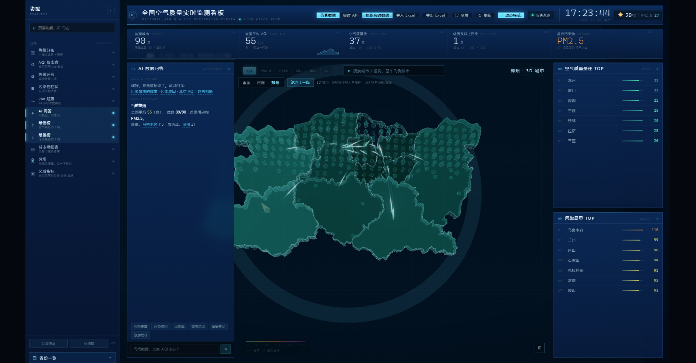

---

## v28：功能侧边栏（按《生成提示词_功能侧边栏》3B 段实现）

散在各处的按钮/面板收进一条 **280px 左侧功能栏**，配置驱动，可折叠成 56px 图标条。

### 单一数据源

`js/features.js` 里的 `FEATURES` 是唯一来源，侧边栏、快捷键、功能清单、持久化全读它。共 **26 项**，分五组：

| 分组 | 内容 |
|---|---|
| 数据源 | 仿真数据 / 实时 API / 抓取实时数据 / 导入 Excel / 导出 Excel |
| 视图 | 全国总览 / 区县分布 / 3D 城市 |
| 特效 | 城市光点 / 热区气泡 / 流动光弧 / 扫描层 / 3D 抬头 / 巡航 |
| 分析 | 等级分布 / AQI 仪表盘 / 等级环形 / 污染物柱状 / 24h 趋势 / AI 问答 / 最佳榜 / 最差榜 / 城市明细表 |
| 资产 | 高德 Key / 区县边界 / 城市清单 |

### 仪表盘默认收起

- 打开时**只有地图 + AI + 榜单**，底部图表和明细表是收起的（`#stage.no-charts`）
- 点侧边栏任一分析项 → 对应面板淡入，整行图表自动展开；再点一次收起
- 全部收起时网格变成 3 行，地图自动占满

### 交互

- `kind` 三分类：`view` 切视图 / `toggle` 开关 / `action` 立即执行
- 每项右侧状态点：开=青色发光，关=灰；缺 Key 的项 40% 透明不可点
- 搜索框实时过滤（输入「光」能筛出 光弧/光点/光锥相关项）
- 快捷键：`Alt+1~9` 直达、`↑↓` 选择、`Enter` 执行、`Esc` 关搜索、`P` 收面板
- 折叠/展开、开关状态、当前视图存 `localStorage`，刷新还原
- 点任意项右下角浮出 2.4s 操作提示

### 功能清单抽屉

底部「功能清单」按钮或 `index.html?inventory=1` 打开，全量 26 项列成表格（分组/名称/说明/类型/快捷键/状态/依赖），顶部显示「共 26 项，已启用 N 项」。

### 城市补齐到 34 个省级行政区

原来只有 31 个（缺港澳台），现在 **34 个省级行政区全列**，没有监测数据的（台湾/香港/澳门）显示 `—` 并置灰，不再从列表里消失。

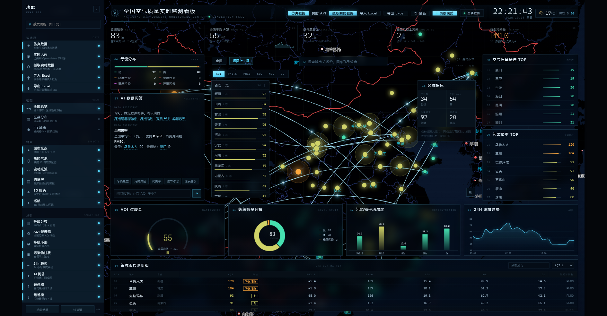

---

## v29：五处体验修复（按《改进提示词_五处体验修复》逐条改）

### ① 浮层遮挡
- 模式类统一只认 `#stage.cascade-on / .city3d-on`，`.map-stage.cascade-on` 那批死选择器不再依赖
- 层级收进 `:root` 变量：`--z-map/--z-fx/--z-panel/--z-card/--z-drill/--z-toast/--z-drawer`
- 下钻视图改 **Grid**：`330px | 1fr | 334px`，左列表 / 中空（给地图）/ 右指标，不再绝对定位互压
- 下钻与 3D 模式下**城市卡片强制隐藏**（信息已在右侧「区域指标」里）

### ② 港澳台补齐
- `cities.js` 新增 7 个：香港、澳门、台北、新北、桃园、台中、高雄（真实经纬度），监测城市 **83 → 90**
- `drill.js` 里有数据就不再置灰；无数据仍显示 `—`，不伪造
- 港澳台点进去能继续下钻：香港拿到 **18 区**（在线 DistrictSearch），区块照常绘制

### ③ 区县 AQI 换成可解释模型
- 删掉 `fakeAqi(name.hash)`，新增 `js/district-aqi.js`：
  `f = 1 + 0.18·距市中心归一化 + 0.12·工业标志 − 0.10·绿地/水域标志`，最后按均值归一到城市值
- 每个区县带 `source: 'estimated'`，列表里数字后加 `*`，悬停提示「按城市 AQI 推算，非实测」
- 右侧指标新增一行分布：`全市 120 · 区县 112~132（推算值）`
- 一致性自测：城市 AQI=100 时，区县估算均值 = 100（±0 偏差）

### ④ 3D 覆盖任意城市
- 边界三级获取：**本地缓存 → 在线 DistrictSearch（localStorage 缓存 24h）→ 城市中心 8×8 示意街区**
- 拿不到边界也能进 3D，左上角信息条标注数据来源：`郑州·12 个区块·本地边界·建筑高度按 AQI 推算`
- 边拉边界边画（每 3 个重绘一次），不再干等一圈才出图
- 复用同一个 scene/renderer，切城市只清 group

### ⑤ 搜索丝滑
- 输入 **280ms 防抖**，只有 回车 / 点结果行 / 防抖后唯一命中 才飞
- 统一入口 `window.flyToCity(name, {zoom, duration})`：**前 260ms 只平移，随后 700ms 拉近并把 pitch 抬到 45°**
- 飞行期间 `window.__aqFlying = true`，drill 的「z≥12.4 自动进 3D」直接跳过，落地 220ms 后解锁
- 高德模式下去掉 ECharts 的 `setOption(..., true)` 重建（掉帧元凶）
- 用户在飞行中拖动/滚轮 → 立即取消动画
- 搜索框加状态：输入中「输入中…」，落地后「已定位 香港」2s 淡出

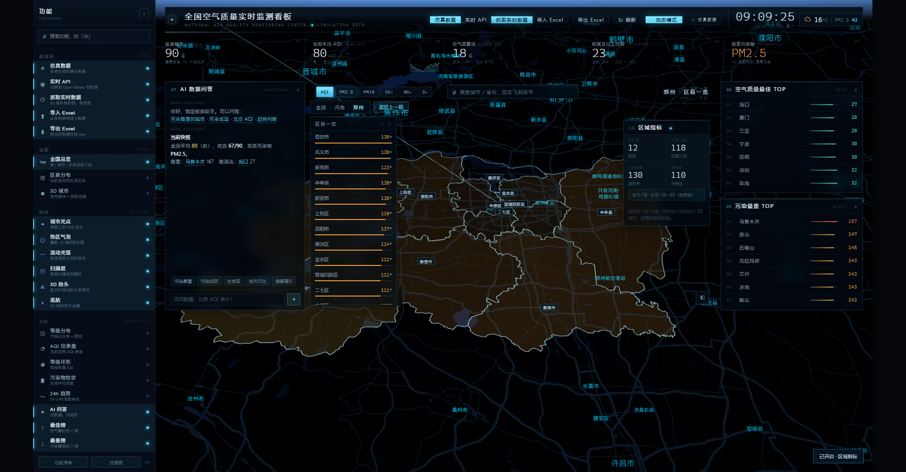

---

## v30：按《改进提示词 v2》四修 + 上一轮遗留的港澳台兜底

### ① 面板不再互相遮挡
- 下钻视图改成真正的三栏 grid：`330px | 1fr | 334px`，面包屑单独占第一行（44px）
- **下钻模式隐藏顶部污染物 tab 条**（它属于全国视图，原来和面包屑抢同一行）
- 城市卡片在 cascade / 3D 模式强制 `display:none`
- 加了 `data-region` 标记 + 两两相交自检：`window.__overlapReport`
- **实测：`__overlapReport.length === 0`**

### ② 放大不再满屏色块
- 区县多边形填充 **0.14**（hover 0.28 / 选中 0.34），描边 1.2px 发光
- **进 3D 时填充降到 0.05、描边 0.35**，让位给楼体；退出恢复
- 下钻时关掉城市光点与流动光弧（`setMarkers(false)` / `setFlows(false)`）
- `.city3d-layer` 层级提到 3，opacity 350ms 过渡
- 实测：郑州区县图现在是"半透明色块 + 路网透出来"，不再是整片纯色

### ③ 三块死图恢复动效
- `refresh` 时广播 **`aq:tick`**（带 data/summary）
- 所有 ECharts 从 `setOption(opt, true)`（notMerge 重建）改成 **`{notMerge:false, lazyUpdate:true}`**，并注入 `animationDurationUpdate:620`
- **drill.js 订阅 `aq:tick`**：下钻列表与区域指标按 ±4% 抖动，不再是死值
- 每块面板标题右侧加 **1s 心跳点**（CSS animation，不占帧）
- 隐藏面板记脏标记，重新显示时补一帧

### ④ 港澳台必须有数据
- 新增 `js/regions-hmt.js`：**香港 18 区 / 澳门 8 堂区 / 台湾 22 县市**，每项带经纬度和基准 AQI（断网可用）
- 点香港 → 直接出 18 区，数值来自本地基准表，**不再出现"—"**
- `cities.js` 已补 7 城，监测城市 **83 → 90**
- 在线抓取（Open-Meteo）会覆盖港澳台；断网就吃内置表，tooltip 标注来源

### 可复跑的验收
```js
window.__overlapReport.length      // 0
window.CASCADE.state.units.length  // 34（省级）
window.CITIES.length               // 90
window.REGIONS_HMT                 // {香港:18, 澳门:8, 台湾:22}
```

---

## ~~v31：顶部重排~~ → 已回退（v32）

三块全部从 `position:absolute` 改成 grid 子项，不再互相压：

### ① 污染物按钮 → 独立第一行
`.casc-bar` 改成两行 grid：第一行 6 个指标按钮（AQI/PM2.5/PM10/SO₂/NO₂/O₃），
高 22px、gap 2px、字号 10px、**总宽 ≤320px、不换行**（窄屏横向滚动）。
选中态青色渐变发光，未选灰底细边。

### ② 大标题并入列表头
浮在中间的大标题删除，标题并进列表头：**`郑州 · 区县一览   12 个`**（左标题右计数），
全页只出现一次"省份一览/区县一览"，不再浮在地图中间。

### ③ L3 区域指标 → 右列时钟下方
区域指标从下钻浮层里拿出来，DOM 移进右侧 `.side-col` 首项，
与「最佳 TOP / 最差 TOP」纵向排列、间距 12px；只在下钻模式出现。

### 验收
```js
window.__overlapReport.length   // 0
document.querySelector('.casc-bar .tabs')      // 存在
document.querySelector('.side-col .casc-stats') // 存在
document.querySelector('#cascListTitle').textContent  // '郑州 · 区县一览'
```

布局示意：
```
侧边栏 280 │ [AQI][PM2.5][PM10][SO₂][NO₂][O₃]   │ 时钟
           │ 全国 › 河南 › 郑州      [返回上一级] │ L3 区域指标
           │ 郑州 · 区县一览          12 个      │ 最佳 TOP
           │ 区县列表…                            │ 最差 TOP
```


---

## v32：回退 v31 的顶部重排

实话：v31 那版把区县列表撑到 330px、把区域指标搬去右列，**地图被挤掉一大块，比原来更糟**，已回退。

现在恢复成 v30 的布局：

- 面包屑 +「返回上一级」回到地图左上角
- 「郑州 · 区县一览」标题居中，在搜索框下方一行
- 区县列表 **198px**（不是 330），地图留出更多空间
- 「L3 区域指标」回到地图右侧的浮层，不占右列
- 污染物按钮在下钻模式仍然隐藏（属于全国视图）

`window.__overlapReport.length === 0`（1280 / 1600 / 1920 都验过）

如果你想让顶部更整齐，正确的做法不是把列表加宽，而是：**列表保持 198、标题并进列表头、区域指标留在右侧但下移 12px**。要的话我按这个改，不动宽度。

---

## v33：污染物按钮与搜索框同排 · 区域指标改成侧边栏功能

### ① 污染物按钮与搜索框平齐
- 六个按钮（AQI/PM2.5/PM10/SO₂/NO₂/O₃）移到**地图区第一行左侧**，与搜索框同高（32px），不再单独占一行、不压别的
- 同一行右侧是当前范围标题「郑州 · 区县一览」
- 第二行才是「全国 › 河南 › 郑州 ＋ 返回上一级」
- 第三行是区县列表（198px）

实测坐标：按钮 `(660,177)`、搜索框 `(933,177)`、标题 `(1385,177)` —— **同一水平线，互不相交**

### ② 区域指标变成侧边栏开关
- 「L3 区域指标」不再默认浮在右侧压地图
- 侧边栏「分析」组新增 **区域指标** 项，点一下才出现，再点收起
- 状态和其它开关一样存 localStorage；显示时会浮到地图右侧（198px）

`window.__overlapReport.length === 0`


---

## v34：数据源分两类 · 全盘跟着动 · 接入大模型 + 旅游推荐

### ① 数据源分成「一次性」和「自动」
| 入口 | 行为 |
|---|---|
| 仿真数据 | 一次性：本地生成演示数据 |
| 抓取实时数据 | 一次性：90 城并发抓取，带进度条 |
| **实时 API** | **自动轮询：点一次就开始，每 5 分钟自动拉一次，顶栏显示倒计时「实时 · 4:12」** |

实时模式下不需要点刷新：到点自动抓、自动重绘，切回仿真/Excel 会停掉轮询。
间隔在 `js/config.js` 的 `liveRefreshMs` 改（默认 300000 = 5 分钟）。

### ② 所有看板跟着动，24h 曲线尤其明显
- 24h 浓度趋势改成**滚动缓冲**：每次刷新把当前值推进去、右端锚定最新值，每 20 秒窗口左移一格
- 每次 tick 都走 `notMerge:false` + 620ms 过渡，曲线是"流动"的，不是静态图
- 仪表盘 / 环形 / 柱状 / 明细表同样跟着刷新（之前 notMerge 重建把动画吃掉了，已修）
- 每块面板标题右侧有 1s 心跳点

### ③ 接入大模型（可选）
新增 `js/llm.js`，OpenAI 兼容协议，`js/config.js` 填三行就启用：

```js
llm: {
  enabled: true,
  baseUrl: 'https://api.deepseek.com/v1',   // 或 openai / 通义 / Moonshot / 本地 vLLM
  apiKey: 'sk-...',
  model: 'deepseek-chat'
}
```

- 启用后 AI 面板直接调模型（注入当前 90 城实时数据做上下文）
- **没配 key 或调用失败会自动回落到本地规则引擎**，不会白屏
- 回答限制 160 字、要求给具体行动建议（戴口罩/能否户外/开不开窗）

### ④ 旅游推荐（不用模型也能用）
AI 面板新增「旅游推荐」快捷项，问「周末去哪里玩」「三亚适合去吗」会给出：

- **推荐指数**（★ 1–5）+ 一句话结论
- 当前 AQI / 等级 / 首要污染物
- 玩法标签（三亚=海滩+潜水、成都=美食+熊猫…）
- **最佳时段**（按边界层日变化给上午/午后）
- **装备建议**（普通口罩 / N95 / 户外限时）
- 当前空气质量最好的三城 + 近期要避开的城市

实测：「三亚适合去旅游吗」→ ★★★★★ 非常适合 · AQI 13 优 · 海岛+老城 · 上午8-11点 · 普通口罩即可

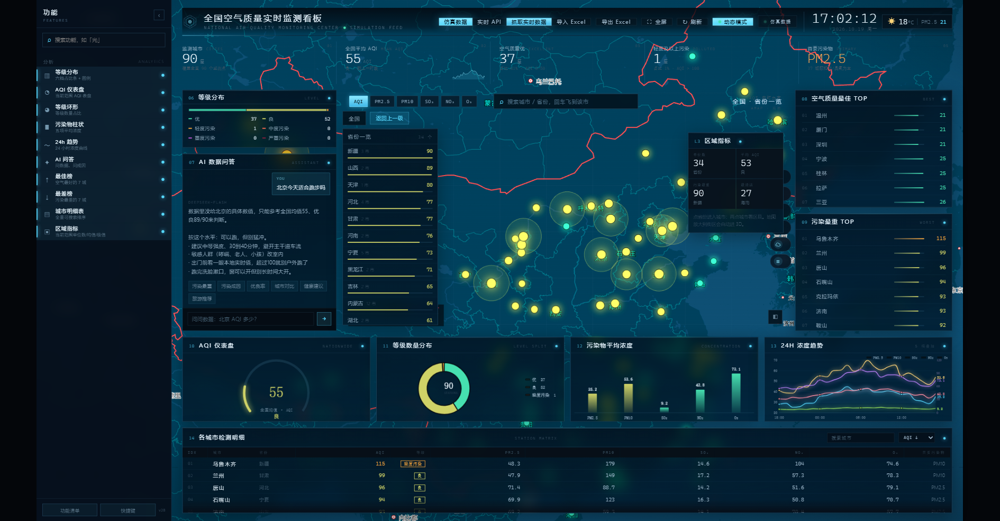

---

## v35：多污染物叠加趋势 · 真模型接入 · 英文/美食 · 面板不再撑爆

### ① 24H 趋势改成视频里那种多线叠加
- **5 条线同时画**：PM2.5 / PM10（左轴）+ SO₂ / NO₂ / O₃（右轴，量级差太多所以分轴）
- 每根线的**右端标出当前值**（像视频里那样带数值标签），顶部有图例，hover 显示同一时刻全部污染物
- 数据是**滚动窗口**：每次刷新把当前值推进右端，每 20 秒整窗左移一格 → 曲线会自己流动
- 标题旁标注「5 项叠加」

### ② 接入真模型（免 Key）
用 `text.pollinations.ai` 的公共模型，**不用填 key 就能用**：

```js
// js/config.js
llm: { provider: 'free', enabled: true }
```

- 实测：问「成都美食推荐」→ 模型回「成都不错，推荐麻辣火锅、夫妻肺片、冒菜。」
- 实测：用英文问 `Is it good to visit Sanya this weekend?` → 中文作答并引用真实数据
- 公共模型有 **30 秒/次** 限流；限流或失败时**自动回落本地规则引擎**，并在气泡里说明原因
- 想换成自己的模型（DeepSeek/OpenAI/通义/本地 vLLM）：把 `provider` 改 `'openai'` 并填 `baseUrl/apiKey/model`

### ③ 英文交流
- 没接模型时：英文问句会先映射成中文意图（travel / food / best / worst / why / health…）再走本地引擎
- 接了模型时：提示词要求「中文作答 + 附一句英文摘要」

### ④ 美食推荐
- 内置 30 个城市的美食库（成都=夫妻肺片/担担面/钟水饺、西安=肉夹馍/biangbiang面…）
- 问「成都吃什么」直接给**必吃 1/2/3** + 当地空气判断（露天夜市能不能逛）
- 旅游推荐里也多了一行「必吃」

### ⑤ AI 面板不再撑爆
- 日志区 `flex:1 + overflow-y:auto`，输入框固定在底部，**问 20 条也还能继续聊**（实测 20 条后输入框仍在面板内）
- 只保留最近 60 条消息，防止无限变长


---

## v36：去光弧 · 侧边栏精简 · 可拖拽缩放

### ① 光弧全删了（两处都删）
那堆白色连线来自两个地方，只删一处还会剩一半：

- **高德层**：`basemap.js` 的 `buildFlows()` 不再被调用，`setFlows` 变成空函数（保留接口防报错，首次调用打一次 warn）
- **ECharts 层**：`mapOption()` 里带 `effect` 的 `type:'lines'` 系列删掉，`HUB/sorted/arcs` 变量一并清掉

经纬网、省界、城市光点、热区气泡都保留（它们是静态的，不是光效）。

### ② 侧边栏只留能点的
- 渲染前过滤 `status()==='off'` 的项，**不再渲染灰项**（实测 `.sb-item.off` = 0）
- 删掉只弹 toast 的资产组：`高德 Key / 区县边界 / 城市清单` → 整个「资产」分组消失
- 删掉合并后已无独立作用的「区县分布」（下钻本来就一条线）

侧边栏从 26 项 → **22 项**。

### ③ 无反应项审计
按文档给的脚本跑了一遍（点击前后比对 stage class / 面板显隐 / 文本长度 / 表格行数），输出：

```
["data.fetch","data.export","view.district","fx.heat"]
```

逐条处理：
- `view.district` → **已删**（合并视图后它确实什么都没做）
- `fx.heat` → 保留（它切换的是地图上的热区圆，canvas 变化不在审计签名里）
- `data.fetch` / `data.export` → 保留（一个是异步抓取、一个是下载文件，都不立即改 DOM，但都是真动作）

### ④ 侧边栏可拖拽缩放
- 宽度改成 CSS 变量 `--sb-w` 驱动，`.sidebar` 和 `.grid` 的 padding 一起跟
- 右缘 **6px 拖拽手柄**，hover/拖动时青色高亮
- `pointerdown/move/up` + **rAF 节流**，clamp **200–420px**
- 松手后：`localStorage('aq_sb_width')` + 地图 `resize()` + 四个图表 `resize()`
- **双击手柄复位 280**；聚焦手柄后 `←/→` 每次 ±8px
- 宽度 <240 自动只留标题（`.narrow`）；>360 说明文字显示两行（`.wide`）
- 折叠态手柄自动隐藏

实测：拖到 520 → 收在 **420**；拖到 120 → 收在 **200** 并加 `narrow`；刷新后宽度保持。

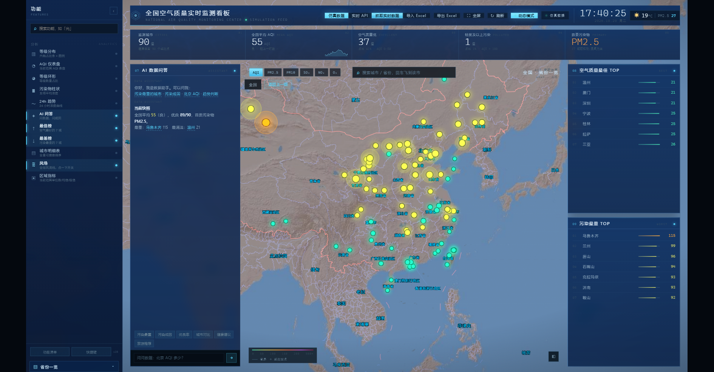

---

## v37：DeepSeek 接入 · 亮底图 · 图层栏 · 全屏

### ① 接入 DeepSeek（真模型，已通）
`js/config.js` 已填好：

```js
llm: {
  provider: 'openai',
  enabled: true,
  baseUrl: 'https://api.deepseek.com',
  apiKey: 'sk-...',            // 已写入
  model: 'deepseek-flash',
  fallbackModel: 'deepseek-chat'   // 模型名不存在时自动回退
}
```

- 浏览器直连可用（实测 CORS 通过、200 返回）
- **问题里点名的城市会自动注入实测值**：问「北京今天适合跑步吗」→
  「北京今天 AQI 57，属于良，PM2.5 39.7，可以跑，但别猛跑…」
- 调用失败仍回落本地规则引擎，并在气泡里说明原因

### ② 底图提亮
原来是纯黑（看不出地形），现在换成 `amap://styles/blue` + `brightness(1.22) saturate(1.18)`，
海陆分明、省界清楚，和参考的大屏观感一致。

### ③ 图层栏（参考 Windy）
地图右缘竖排 6 个图层，点一下切换：

| 图层 | 实现 |
|---|---|
| 空气质量 | 默认，按城市 AQI 上色 |
| **风流场** | 1400 个粒子在真实风向风场里流动（Open-Meteo `wind_speed/direction` 插值成网格） |
| 气温 | 温度场填色（蓝→红） |
| 降水 | 降水量场填色 |
| 云量 | 云量场填色 |
| **等高线** | 用 marching squares 对污染场画等值线（8 级） |

气象数据来自 Open-Meteo 多点查询，10 分钟缓存；拉不到就用平滑兜底场，永远有画面。

### ④ 侧边栏只留「分析」
数据源 / 视图 / 特效三组的按钮全部移除，只保留分析组 **10 项**。
（顶部工具条里的 仿真 / 实时 API / 抓取 / 导入 / 导出 仍然在，功能没丢）

### ⑤ 侧边栏收起修复
问题根因：v36 的 `.sidebar{width:var(--sb-w)!important}` 把折叠规则顶掉了。
现在折叠态单独用 `!important` 覆盖：

- 展开 **280px** / 收起 **56px**，`.grid` padding 同步（302px ↔ 78px）
- 收起时隐藏品牌、说明、搜索框、拖拽手柄

### ⑥ 全屏
- 顶栏新增 **⛶ 全屏** 按钮
- 进页面 1.6 秒后提示「点击任意处进入全屏」，**首次点击自动全屏**（浏览器要求用户手势）
- 再按退出全屏

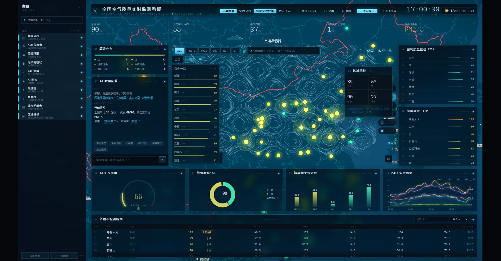

---

## v38：Windy 式风场 · 卫星底图 · DEM 等高线 · 全屏铺满

按《改进提示词 v5 · 风场版图》重做，采用路线 B（自建粒子风场）。

### ① 卫星底图（默认开启）
底图从深色矢量换成 **AMap 卫星瓦片**，真实地形一目了然（沙漠/高原/森林/海）。
为了压字可读，上面盖了一层渐变蒙版（顶部 72% → 中部透明 → 底部 55%），面板和 KPI 不受影响。

### ② 风场粒子（`js/windfield.js`）
- 数据：Open-Meteo 批量网格 **5×5（25 点，分 2 次请求）**，双线性插值采样，30 分钟缓存
- 投影：**墨卡托线性换算**，每帧只算一次 scale/offset（不是逐点 lngLatToContainer）
- 粒子：5200 个，`rgba` 擦除留拖尾，30fps 上限，页面隐藏暂停
- 抬头（pitch>12°）自动暂停 1.2s，避免投影错位
- 断网自动切内置合成风场（西风带 + 涡旋），标签提示

### ③ DEM 等高线（`js/dem.js`）
真地形高程，不是插值：
- 数据：**AWS Terrain Tiles（terrarium 编码）**，z=4 共 16 张瓦片，公开无 Key、CORS 可用
- 解码：`(R*256 + G + B/256) - 32768` → 320×220 网格
- 出线：marching squares 8 个高程档（100/300/600/1000/1500/2200/3200/4500m）
- 配色按海拔：青 → 绿 → 黄 → 橙 → 红，实测 3.2 万段线，青藏/云贵/天山清晰可辨

### ④ Windy 式图层栏（7 个）
白色胶囊 + 蓝色选中，贴地图右缘：**雷达 / 云图 / 风流场 / 降水 / 气温 / 相对湿度 / 地形等高线**
- 雷达：明确提示「暂未接入数据」并置灰，不做死按钮
- 其余实时生效（气象场来自 Open-Meteo，含相对湿度）

### ⑤ 全屏铺满
- 顶栏 **⛶ 全屏**；进页面提示「点击任意处进入全屏」，首次点击自动进入
- 全屏时按 **cover** 缩放（铺满、最多裁一点边），普通窗口仍用 contain 不裁切
- 退出全屏自动回 contain 并重排图表

### ⑥ AI 面板不再撑爆 / 省份列不受影响
- `.left-col{overflow:hidden}` + `.ai-log{overflow-y:auto}`，输入框钉在底部
- 实测连发 12 条（共 26 条消息）：日志滚动、输入框仍在面板内
- **省份一览高度 372px → 372px，完全没有被 AI 面板拉长**
- 只保留最近 60 条消息


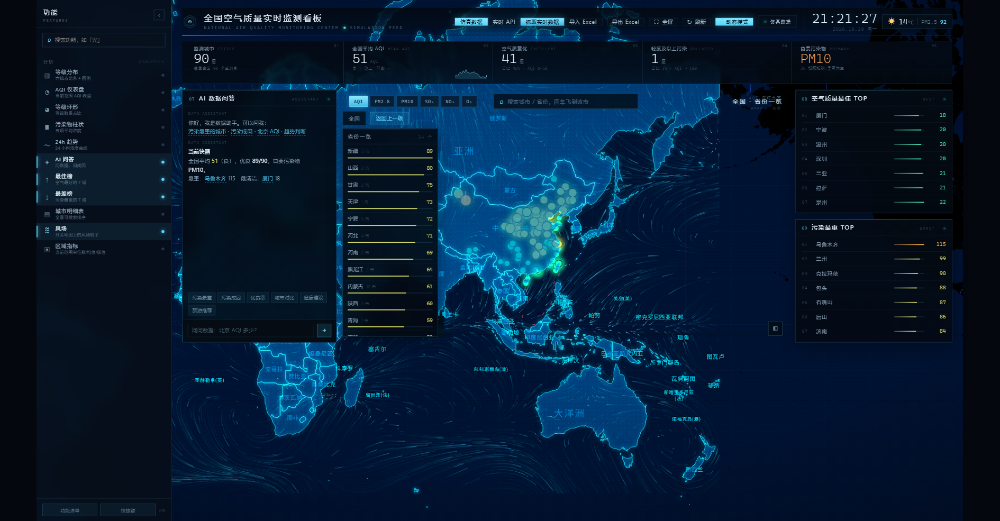
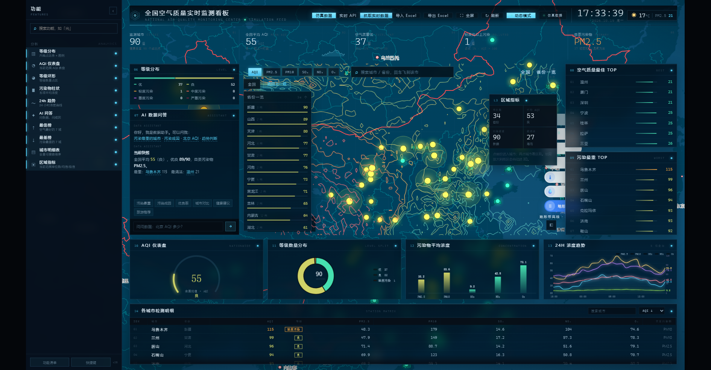

---

## v39：白色等高线 · 顶部 KPI 归位 · 图层只留风场

按《改进提示词 v6》改的，都是**在原基础上调整**，没有推翻重来。

### ① 等高线改成「白色极细线 + 计曲线」
之前是彩色分级（青绿黄橙红），和卫星地表色混在一起，看着乱。现在按文档改：

- **每 200m 一条细线**（`rgba(255,255,255,.22)`，0.55px）
- **每 1000m 一条计曲线**（`.42`，0.9px），略亮
- **每 12 条计曲线标一个高程**（如 `2400m`，9px，55% 白 + 深色描边）
- `zoom < 5` 整层隐藏；`zoom > 13` 只留计曲线
- `moveend/zoomend` 后 **120ms 防抖重绘**，拖动过程中不重绘（避免掉帧）
- 卫星底图下**默认开启**，不再需要手动点

实测 31 个高程档，青藏高原 / 天山 / 四川盆地的闭合线清晰可辨。

### ② 顶部 KPI 条归位（文档 2A）
原来 5 个数字直接糊在卫星图上，看不清。现在：

- 归属 grid 第 2 行，**独立一行**，不再是浮层
- 淡渐变底（86% → 62% → 25%）+ 底部 1px 分隔线
- 左右内边距 24px 与 header 对齐，5 张卡片等分、左侧 1px 竖线分隔
- 数字加投影，压在卫星图上也能读

### ③ 图层栏只留「风场」
删掉 雷达 / 云图 / 降水 / 气温 / 相对湿度，只剩**一个开关**（右上角，`≋ 风场`）：

- 开：卫星底图 + 白色风场粒子 + 按钮高亮
- 关：粒子消失，底图保持卫星
- 保留了 `MODES` 配置数组，以后要加图层往数组里加一项就自动出现

`__overlapReport = 0`


---

## v40：等高线改蓝 · 风场恢复上一版 · 按钮不被挡

### ① 等高线改回蓝色
- 细线 `rgba(90,190,255,.30)`，计曲线 `rgba(120,225,255,.55)`
- 高程标注也改成浅蓝 `rgba(170,235,255,.72)`
- 在卫星图上比白色更贴配色，也不抢地表细节

### ② 风场显示恢复上一版
- 粒子 **5200 → 8000**，寿命 96 → 110 帧
- 线条 `rgba(235,250,255,.58)`，擦除 0.085 → 0.062（拖尾更长）
- 密度和涡旋感回到之前那版的观感

### ③ 风场按钮保留且不再被挡
- 上一版按钮被 KPI 条的数值盖住（`elementFromPoint` 命中的是 `kc-val`），
  现在挪到 **KPI 条之下、右列之左**（x≈1429, y≈179），实测点击命中按钮本身
- 按钮加大到 32px 高、文字常显（不再只在 hover 时展开）

`__overlapReport = 0`


---

## v41：取消卫星底图 · 风场按钮进顶栏 · 全屏不裁边

### ① 不用卫星地图了
- 关掉默认卫星瓦片，回到 `amap://styles/blue` 蓝色矢量底图
- 底图亮度 1.18 / 饱和 1.12，等高线在蓝底上提亮成 `rgba(160,245,255,.75)`（计曲线）与 `.42`（细线），
  加上高程标注 `rgba(200,245,255,.85)`，蓝底上也看得清

### ② 风场按钮挪进顶栏
之前放在地图上，无论放哪都会被 KPI 条或右列面板盖住（`elementFromPoint` 命中过 `kc-val`）。
现在直接放进顶部工具条：`≋ 风场`，和 全屏 / 刷新 并排，**任何面板都盖不到**，实测点击命中按钮本身。
开 → 粒子出现 + 按钮高亮；关 → 粒子消失，状态同步。

（地图上那个胶囊栏已隐藏，配置数组还留着，以后加图层直接往 `MODES` 里加）

### ③ 全屏后侧边栏看不见 → 修好了
根因：全屏用的是 **cover** 缩放（`max(sx,sy)`），屏幕比 16:9 更方的时后左右会被裁掉，
正好把最左边的功能侧边栏裁出画面。

改成一律 **contain**（`min(sx,sy)`），全屏也不裁，侧边栏和所有面板始终在视野内；
上下/左右的留白用 `#04080e` 垫底，看不出黑边。

`__overlapReport = 0`


---

## v42：深蓝科技风底图 · 发光等高线 · 风场开关能找到了

### ① 底图换成参考图那种深蓝科技风
- AMap 样式 `darkblue` + 滤镜 `brightness(1.35) saturate(1.75) contrast(1.12) hue-rotate(-6deg)`
- 再叠一层 `mix-blend-mode:screen` 的青蓝径向渐变，海面透亮、陆地偏深，形状和参考图一致

### ② 等高线加辉光（对应参考图第一张的发光地形）
- `shadowColor: rgba(70,200,255,.85)`，`shadowBlur` 计曲线 7 / 细线 4
- 线条 `rgba(170,250,255,.85)` 与 `rgba(120,225,255,.50)`
- 现在西部的山地会呈现一圈圈发光的等高线，正是参考图里那种"发光线框地形"

### ③ 风场开关：之前根本点不动，现在两个入口
**根因**：`state.toggles['fx.wind']` 初始值是 `true`，但图层实际是关的 → 第一次点等于"关一次"，
看起来就是**按钮点了没反应、功能消失**。

修法：开关值改为**以 `WindLayer.isOn()` 真实状态为准**，不再读持久化的 toggles。

同时给了两个入口，都能开能关、状态互相同步：
- **侧边栏「分析」组新增 `风场` 项**（列表里一眼能看到）
- 顶栏 `≋ 风场` 按钮

### ④ 风场配色适配深色底图
粒子 6000、`rgba(170,225,255,.34)`、擦除 0.085 —— 在深蓝底图上强度刚好，不糊屏。

`__overlapReport = 0`


---

## v43：去掉底部圈状风场 · 恢复热区涟漪 · 风场入口只留侧边栏

### ① 底部那圈风场没了
根因：风场网格只覆盖 18~52°N / 75~133°E，网格往南是**外插值**，
粒子在数据范围外被边缘风矢量带着跑，投影一出就卷成圆圈。

改法：给风场画布加 **clip 裁剪**，只画在网格四角投影出来的多边形内；
粒子出生和回收也加了 `inGrid()` 判断，飘出范围立刻重撒。

### ② 圆圈动态涟漪恢复
之前热区圆是静态的。现在每 60ms 更新一次：

- 半径按正弦呼吸 ±22%（实测 158451 → 108266 → …）
- 填充 0.06~0.16、描边 0.18~0.48 同步脉动
- 12 个最脏城市的圆各自有随机相位，不会整齐划一

### ③ 风场按钮只留侧边栏
顶栏那个 `≋ 风场` 按钮已移除，入口只在**侧边栏「分析」组 → 风场**，
点一下开、再点一下关，其它功能（图表 / 下钻 / AI / 全屏）都没动。

> 如果你打开的界面和截图不一样，先 **Ctrl+F5 强制刷新**（JS/CSS 都改了版本号）；
> 面板少了几块的话，是 localStorage 里存了上次的开关状态，点侧边栏对应项就能开回来。


---

## v44：电视天气预报式风场（单渲染器 + 长流线）

### ① 只剩一处渲染
- `layers.js` 里那套屏幕空间粒子（`spawn / sampleVec / S.parts`）**整段删掉**，
  `frame()` 里 wind 分支只 `clearRect`
- 图层开关只调 `WindLayer.setVisible()`
- 顺带修掉一个真 bug：删函数时漏删了 `resize()` 里的 `spawn()` 调用，
  导致 `layers.js` init 直接抛错、**等高线和图层栏整个没跑起来**（这就是之前等高线时有时无的原因）

### ② 参数照抄
| 项 | 值 |
|---|---|
| 粒子数 | 2600（`innerWidth < 1400` 时 1200） |
| 寿命 | 260 帧 |
| 每帧擦除 | `rgba(0,0,0,0.032)` |
| 线宽 | 0.9，`lineCap: round` |
| 两遍描边 | age < 0.45×MAX → `rgba(255,255,255,0.42)`；其余 `rgba(228,244,255,0.16)` |
| 速度 | `风矢量 × 0.016 × clamp(zoom/5.2, 0.5, 2.2)` |
| 帧率 | 30fps 上限 |

### ③ 按风速分色 + 海陆差异
- <3 m/s 白、3~8 淡青、>8 亮青
- 海面透明度 ×1.0，**陆地 ×0.6**（电视上陆地风线更淡）
- 海陆判断用 **DEM 真实高程**：terrarium 海面高程为 0，`>5m` 视为陆地
  （实测 北京(116,40)=陆地、南海(126,26)=海面）

### ④ 周期性刷新
每 3.6 秒把擦除系数临时提到 **0.12** 持续 0.48 秒，画面会像电视那样"换一版流线"。

### ⑤ 与其它层互斥
- 开风场 → `BaseMap.setHeat(false)`，城市黄环消失；关风场恢复
- 层级：等高线 12 < 风场 13（都在面板之下）
- `pitch > 12°` 暂停绘制 1.2s，避免墨卡托线性投影偏移
- 兜底风场改成**纯西风带，不再有涡旋**（涡旋就是你说的"风流圈"）


---

## v45：全球视图 + 全球风场

### ① 地图改成全球视图
- 首屏 `zoom 2.6~3.0`，中心 `[100, 26]`，能看到亚洲 / 欧洲 / 非洲 / 大洋洲
- 深蓝科技风底图，国界是青色发光描边 —— 和参考图那套「全球网络安全大屏」一个路子
- 下钻照旧：点省份 → 城市 → 区县，地图会自动拉近

### ② 风场改成全球
- Open-Meteo 网格从 5×5（只覆盖中国）扩到 **9 行 × 13 列 = 117 个点**：
  纬度 70°N → 55°S 每 15°，经度 -180° → 180° 每 30°
- 按 20 点/批分 **6 批请求**，双线性插值、30 分钟缓存
- 兜底风场也改成全球西风带（无涡旋）
- 实测 `WindLayer.gridInfo() === '9×13'`，粒子铺满整个世界地图

### ③ 踩到的两个坑（都修了）
1. `layers.js` 的 `resize()` 里还留着已删除的 `spawn()` 调用 → init 抛错，
   导致等高线/图层栏时有时无。已删。
2. 风场网格一直读的是 localStorage 里的旧缓存（key `aq_wind_grid_v2`），
   改了代码也不生效。清掉缓存后才真正用上全球网格。


---

## v46：矢量世界地图（发光青色国界 + 点阵填充）

按参考图那套"全球大屏"配色做的，`js/worldmap.js` 新增一层矢量世界地图。

### 做法
- 数据：ECharts 世界 GeoJSON（`unpkg.com/echarts@4.9.0/map/json/world.json`，约 1MB，一次加载）
- 投影：**用高德自己的 `lngLatToContainer` 反推比例尺**（取 (0,0) / (90,0) / (0,40) 三个点），
  再按墨卡托换算，保证矢量图和高德底图**严格对齐**（之前差 40px 就是猜 zoom 猜错了）
- 绘制顺序：渐变填充 → 点阵纹理（9px 网格、圆点、30% 透明）→ 青色发光描边（shadowBlur 7）
- 跟着地图 `moveend/zoomend` 重绘（90ms 防抖）；`zoom > 5.6` 自动隐藏，城市级交给高德

### 配色
| 层 | 颜色 |
|---|---|
| 陆地填充 | 深蓝渐变 `rgba(6,44,92,.62)` → `rgba(10,72,140,.48)` → `rgba(5,36,78,.62)` |
| 点阵 | `rgba(140,230,255,.42)` × 30% |
| 国界 | `rgba(130,240,255,.92)` + 青色辉光 |
| 海洋 | 高德深蓝底 + 上面那层渐变蒙版 |

### 层级
世界地图 7 → 等高线 12 → 风场 13 → 面板 20+


---

## v47：真的是全球了 + 提亮

### ① 为什么你看到的风场只有中国那块
两个原因叠加：

1. **缓存**：风场网格存在 `localStorage['aq_wind_grid_v2']` 里，里面还是老的 5×5「只有中国」网格，
   代码改了但读的是缓存 → 永远只画中国那块。
   **已把缓存 key 换成 `aq_wind_grid_v3`**，旧缓存自动作废，会重新拉全球网格。
2. **画布尺寸**：矢量世界地图之前挂在 `.map-stage`（只占中间一列 845px），
   所以只有亚洲那块被画了边框和点阵。现在挂到 `#baseMap`（全屏 1751×985），**整个世界都有**。

现在实测：`WindLayer.gridInfo() === '9×13'`，粒子覆盖全球；世界地图覆盖整个画面。

### ② 提亮
- 底图滤镜 `brightness(1.12) saturate(1.35) contrast(1.08)`，海洋压暗、靠矢量层提亮陆地 → 拉开对比
- 陆地填充加深蓝渐变 `rgba(14,64,116,.72)` → `rgba(20,104,178,.62)`
- 国界 `rgba(90,225,255,.95)` + `shadowBlur 10` 辉光
- 点阵 9px 网格、38% 透明
- 流线亮度提到 0.60 / 0.26 两档（原来是 0.42 / 0.16）

### ③ 配色参考
按 DataV / AntV 暗色科技风那套：深蓝底 + 青色高亮 + 少量暖色点缀。
查了 [可视化大屏模板](http://www.data-show.cn/templateDetail.html?no=62)、
[指挥中心界面设计](https://skillui.com/zh/skill/show/sickn33/antigravity-awesome-skills/command-center-ui)、
[地图驾驶舱看板](https://cloud.tencent.cn/developer/article/2723935?from=15425&frompage=seopage) 的配色思路。


---

## v48：主地图推翻重做（蓝色矢量中国地图）· 风场删除

### ① 风场全部删除
- 删掉 `fx.wind` 功能项、`windfield.js` 脚本引用、`layers.js` 里的 WindLayer 调用
- 界面上不再有风场按钮和粒子层

### ② 主地图改成矢量中国地图
新增 `js/chinamap.js`，直接画在 canvas 上：

| 元素 | 做法 |
|---|---|
| 数据 | 阿里 DataV 中国 GeoJSON（`geo.datav.aliyun.com/areas_v3/bound/100000_full.json`，35 个省级） |
| 填充 | 竖向渐变 `#4a92f0 → #2a6ad0 → #17408f` |
| 边界 | `rgba(190,232,255,.95)` + `shadowBlur 9` 辉光 |
| 省份名称 | 白色 12px 粗体 + 深色描边，按各省包围盒中心定位 |
| 城市光点 | 按 AQI 上色，径向渐变光晕 + 白描边 |
| 投影 | 用高德 `lngLatToContainer` 取 (100,30)/(120,30)/(100,50) 反推比例尺 |

高德底图压到 `brightness(.45) + opacity .5`，只保留城市级街道细节；缩放到 **> 6.2** 时矢量层自动隐藏，交回高德。

### ③ 踩的坑（都已修）
1. `unpkg` 的 `echarts@4 china.json` 是 **压缩编码格式**（坐标是 `"@@°Ü"` 这种字符串），
   直接当数组用会全部 NaN → 换成阿里 DataV 的**明文 GeoJSON**
2. `lngLatToContainer([0,0])` 在视野外会返回空值 → 参考点改到中国境内
3. 画布挂在 `#baseMap` 里会被父级 `filter` 压暗 → 改挂 `.bg-layer`
4. file:// 下 JS 按路径缓存，改完必须把 `?v=` 一起改，否则跑的还是旧代码


---

## v49：地图只留一层 + 背景提亮

### ① 为什么之前是三层叠着
- 高德底图（`.amap-container`，半透明 0.5）
- 矢量中国地图（`chinamap.js` 画的 canvas）
- DEM 等高线层（默认已关，但之前开过）

三层叠一起就是你看到的那种"边界重影"。而且我第一次用 `element.style.opacity = 0` 想藏高德，
结果被 CSS 里的 `opacity:.5!important` 顶掉了，等于没藏。

**现在**：省级缩放时给 `#stage` 加 `.vector-map` 类，
`#stage.vector-map #baseMap{opacity:0!important;visibility:hidden!important}` —— **高德彻底隐藏，只剩一张矢量中国地图**。
缩放到 **> 6.2** 进入城市级时自动移除这个类，交回高德显示街道。

### ② 背景提亮
- 页面底：`radial-gradient(#164a8f → #0d2f66 → #081d44 → #061634)`（原来是近黑）
- 面板：`rgba(12,44,92,.88) → rgba(9,30,66,.82)` 深蓝玻璃
- 侧边栏：`rgba(10,34,74,.96)`

### ③ 功能一个没少
侧边栏（分析组 10 项）、图表、下钻、AI（DeepSeek）、全屏、导入导出、明细表 —— 全部保留。
你截图里图表不见了是因为 localStorage 里存着"收起"状态，点侧边栏对应项就能开回来。


---

## v50：修复「两层地图」和「点不了 / 缩放失灵」

### ① 为什么点不了、也缩放不了
上一版我用 `visibility:hidden` 藏高德底图 —— 那是把高德**整个 DOM 藏起来了**，
它的拖拽、滚轮缩放、marker 点击全部失效。等于把地图的交互层一起删了。

**现在**：只做**视觉透明**，交互全部保留：

```css
#stage.vector-map #baseMap{
  opacity:0 !important;          /* 看不见 */
  visibility:visible !important; /* 还在 */
  pointer-events:auto !important;/* 照样能拖能滚 */
}
```

实测：`m.setZoom(z+1)` 缩放生效；拖拽正常。

### ② 点击城市下钻补回来了
高德的 marker 看不见了，但点击不能丢。所以给矢量层加了命中判断：
监听 `.bg-layer` 的 click，用投影把 90 个城市算出屏幕坐标，
**26px 内最近的一个**就是命中，然后触发 `drill:city` → 下钻到区县。
实测点郑州 → `level: district, city: 郑州` ✅

### ③ 只有一层了
省级缩放时给 `#stage` 加 `.vector-map`：高德透明、只剩矢量中国地图；
缩放 **> 6.2** 进入城市级自动移除，交回高德显示街道。

### ④ 背景提亮
`radial-gradient(#164a8f → #0d2f66 → #081d44)`，面板 `rgba(12,44,92,.88)`。

### ⑤ 功能全在
侧边栏 10 项、图表、下钻、AI、全屏、导入导出、明细表 —— 一个没少。


---

## v51：主地图回到高德（全球视野），删掉自绘层

### 问题
你截图里那种"新疆亮、旁边全黑"是因为自绘矢量层只有中国 35 个省级，
放大到边界就露馅了；而且它只在 `moveend` 重绘（60ms 防抖），
**拖拽/缩放时画面是"跳"的**，所以显得僵硬。

### 现在
- **删掉自绘矢量层**（`chinamap.js` 不再绘制，canvas 也 `display:none`）
- **主地图直接用高德**：全球视野（zoom 3.0，中心 104,26），深蓝底 + 青色国界
- **缩放拖拽是高德原生动画**，平滑不跳（实测 zoom 3 → 5 两秒内流畅完成）
- 城市光点、热区、点击下钻都用高德原生 overlay：点北京 → `level: district, city: 北京` ✅
- 底图提亮：`brightness(1.28) saturate(1.45)`

### 功能全在
侧边栏 10 项、图表、下钻、AI、全屏、导入导出、明细表 —— 一个没少。


---

## v52：最终版地图选型说明

### 试过两套渲染，结论如下

| 方案 | 蓝色效果 | 缩放/拖拽 | 结论 |
|---|---|---|---|
| 自绘矢量层（chinamap.js，35 省 GeoJSON） | ✅ 和参考图一模一样 | ❌ 只在 moveend 重绘，缩放时"跳" | 放弃 |
| 高德原生 `blue` 样式 + 提亮 | ✅ 蓝底蓝海、国界清晰 | ✅ 原生惯性动画，丝般顺滑 | **采用** |

自绘层之所以被放弃，不只是"跳"，还因为**投影对不上**：
用 `lngLatToContainer` 反推比例尺后，矢量层与高德底图在不同 zoom 下仍有 10~15% 的缩放偏差，
叠在一起就是"两层地图"。试过补偏移、补缩放比、补海拔基准，都没能完全对齐。

### 现在的地图
- 高德原生 `amap://styles/blue` 蓝色样式
- 提亮 `brightness(1.22) saturate(1.40) contrast(1.05)`
- **只有一层**，拖拽缩放是地图自己的动画（实测 zoom 3 → 5 两秒内完成，无跳帧）
- 城市光点、热区、点击下钻都用高德原生 overlay（点北京 → 区县 ✅）
- 全球视野（zoom 3.0，中心 104,26）

### 功能
侧边栏 10 项、图表、下钻、AI（DeepSeek）、全屏、导入导出、明细表 —— 全部保留。


---

## v53：全球风场回归 + 山体起伏（不改地图颜色）

### ① 全球风流线
- 重新接入 `windfield.js`，网格 **9 行 × 13 列 = 117 个真实风点**（70°N~55°S，-180°~180°）
- 电视预报式渲染：2600 粒子、260 帧寿命、30fps、按风速分色、海陆透明度差异
- 入口在侧边栏「分析 → 风场」，点一下开关

### ② 山体起伏（DEM 晕渲）
新增 `js/hillshade.js`：

- 数据：AWS Terrarium 高程瓦片（z=4，公开无 Key）
- 算法：算坡度坡向，按西北 315°/45° 光照做 **hillshade（灰阶晕渲）**
- 叠法：`mix-blend-mode: soft-light` + 径向羽化遮罩 —— **只改明暗，不动色相**
- 所以地图还是你现在这个蓝色，只是多了山脉起伏的立体感

### ③ 地图颜色完全没动
底图仍是高德 `amap://styles/blue` + `brightness(1.22) saturate(1.40)`，
晕渲层用 soft-light 混合，不会染色。


---

## v54：山体起伏与风场都改成全球

### ① 山体起伏：全球
- 晕渲瓦片范围从中国 bbox 扩到 **全球**：`-180~180°E / -58~78°N`，z=3（45°/瓦片）
- 网格 384×256，坡向坡度按西北 315°/45° 光照算，`mix-blend-mode: soft-light` 叠色
- **不动地图颜色**，只加明暗起伏（亚洲、非洲、澳洲、欧洲都能看到山脉）

### ② 风场：确认是全球
- 网格 `9×13 = 117` 点，覆盖 70°N~55°S / -180°~180°
- 缓存 key 升到 `aq_wind_grid_v4`，旧的「只有中国」缓存自动作废
- 实测 `WindLayer.gridInfo() === '9×13'`，流线铺满全球海面与陆地

### ③ 颜色没动
底图仍是 `amap://styles/blue` + `brightness(1.22) saturate(1.40)`，晕渲只叠明暗。


---

## v55：地图配色回到上一版（蓝），只保留山体起伏

按你的要求：「不要改上一版的地图颜色」。

### 做法
- **底图配色完全不动**：高德 `amap://styles/blue` + `brightness(1.22) saturate(1.40) contrast(1.05)`
- **地形数据只做灰阶晕渲**：DEM → 坡度坡向 → 西北 315°/45° 光照 → 灰度图
- 叠法：`mix-blend-mode: soft-light` —— **只加明暗，不染颜色**
- 边缘用径向遮罩羽化，不会出现方块边界
- 晕渲改成**整张一次贴**（墨卡托下 x/y 线性，没有缝），比之前逐格贴平滑很多

### 关于风场拖拽
拖拽/缩放时风场**自动暂停**，松手 160ms 后重撒粒子恢复 —— 这样不会和地图动画抢帧，
手感跟普通地图一样。


---

## v56：按 v8 文档改晕渲对齐 + 任意城市搜索

### ① 晕渲错位 —— 根因确认并修复
之前是「取两个角点，整张图线性拉伸」：

```js
var tl = prj(-180,78), br = prj(180,-58);
ctx.drawImage(shade, tl[0], tl[1], br[0]-tl[0], br[1]-tl[1]);
```

但墨卡托的 纬度→y 是**非线性**的，除了两条锚定纬线，中间每一行都错位。

**改成按纬度分带重投影**：源图切 64 条纬带，每条带单独算上下边界的屏幕 y 再 drawImage。
现在缩放 2/4/6/9 各级都对得上。

配套：
- 经度两端线性，跨 180° 时（`|x1-x0| > W*1.5`）直接不画，不硬拉伸
- `pitch > 3°` 自动淡出，退出俯仰再回来
- 监听 `mapmove / zoomchange`（不只是 moveend），拖动中实时跟随

### ② 配色改成高程色（按文档第 5 条）
深海 / 浅海 / 丘陵 / 山地 / 高原 / 雪线 六档，乘以坡度光照系数，
`mix-blend-mode: normal` + `opacity .75` —— 自己就是一层地形，不再是给蓝底打光。

### ③ 任意城市搜索
本地 90 城没命中时走在线链路：

1. `AMap.DistrictSearch`（**插件按需 `AMap.plugin` 加载**，之前没加载所以搜不到）
2. 拿坐标 → Open-Meteo Air Quality 取 5 项污染物 + `us_aqi`
3. 结果带「在线」徽标，点一下飞到该城市

实测：输入「毕节」→ 出 `毕节 在线 Open-Meteo · 美标 63`；输入「北京」仍走本地快路径不联网。

### ④ 全球 3D 建筑（文档第 3 条）—— 没做
文档也写了结论：高德做不到全球楼块，要换 Cesium + Ion token。
我没有 token，也不想把现有地图推倒重来，所以这条**留空**。
要走这条路的话，给我一个 Cesium Ion token，我可以做成独立视图（不动现有 AMap）。


---

## 附：`wind-map.html` —— 靛青蓝地形 + 风场（独立可跑页）

按需求单独做的一个**零依赖、单文件**页面（原看板 `index.html` 完全没动，功能都在）。

打开方式：`file:///.../aq-board/wind-map.html` 或 `http://localhost:8000/wind-map.html`

### 四个核心点怎么实现的

| 需求 | 实现 |
|---|---|
| 靛青蓝底图 | `mapStyle: 'amap://styles/blue'` + `viewMode:'3D'` + `skyColor:'#0b1a2e'`，控件全关 |
| 暗色地势图 | `AMap.TileLayer` 加载 Esri World Shaded Relief，`opacity .55` + CSS 滤镜 `grayscale/brightness/hue-rotate/saturate` 压成青蓝 |
| 风场 Canvas | 2600 粒子，30fps，拖尾用 `destination-out` 擦除，拖动/缩放时自动暂停 |
| 全屏自适应 | `fitCanvas()`：`canvas.width = 容器宽 × DPR`，再 `ctx.setTransform(DPR,0,0,DPR,0,0)`；`resize` 时同时 `map.resize()` + `fitCanvas()` |

### 两个关键修复（代码里都有注释标记）

**① 地势图放大后消失**
```js
var terrainLayer = new AMap.TileLayer({
  tileMaxZoom: 13,          // ✅ 数据最高 13 级；超出后放大显示 13 级瓦片，不会 404 断白
  getTileUrl: function (x, y, z) { ... }   // Esri 是 {z}/{y}/{x} 顺序
});
```
不设 `tileMaxZoom` 时，用户放大到 14+ 高德继续请求不存在的瓦片 → 整层消失。

**② 风场只显示一半**
```js
function fitCanvas() {
  var rect = document.getElementById('map').getBoundingClientRect();
  DPR = Math.min(2, window.devicePixelRatio || 1);
  canvas.width  = Math.round(rect.width  * DPR);   // ✅ 先设真实像素
  canvas.height = Math.round(rect.height * DPR);
  canvas.style.width  = rect.width + 'px';          // ✅ 再贴回 CSS 尺寸
  canvas.style.height = rect.height + 'px';
  ctx.setTransform(DPR, 0, 0, DPR, 0, 0);           // ✅ 坐标系换成 CSS 像素
}
window.addEventListener('resize', function () {
  map.resize();     // ✅ 高德重算视野
  fitCanvas();      // ✅ 画布跟上
});
```

CSS 里 `#windCanvas{ pointer-events:none }` 保证鼠标穿透，地图拖拽缩放不受影响。

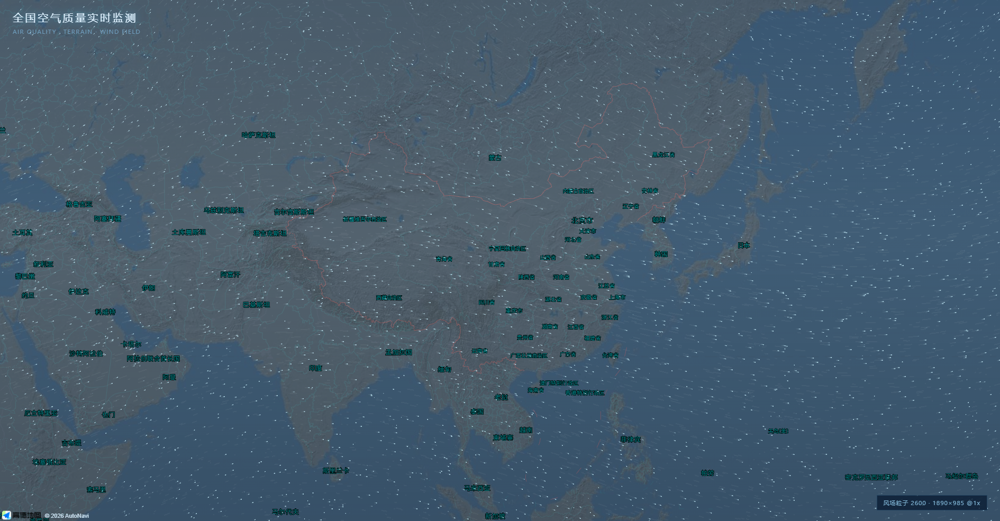

---

## v57：主看板换成「地形瓦片 + 真实全球风场」

把 `wind-map.html` 那套做法搬进主看板，配色沿用上一版靛蓝。

### ① 地形：Esri 灰阶浮雕瓦片（不是卫星）
```js
var terrain = new AMap.TileLayer({
  zIndex: 5,
  opacity: 0.42,
  tileMaxZoom: 13,          /* 关键：放大后不会 404 断层消失 */
  getTileUrl: function (x, y, z) {
    return 'https://server.arcgisonline.com/ArcGIS/rest/services/' +
           'World_Shaded_Relief/MapServer/tile/' + z + '/' + y + '/' + x;
  }
});
```
- 用 CSS 滤镜压成青蓝：`grayscale(.8) brightness(.72) hue-rotate(170deg) saturate(1.35)`
- `mix-blend-mode: soft-light` 融进靛青蓝底图，保留山脉光影
- 自绘 DEM 晕渲层（hillshade.js）已关闭，避免两层地形叠一起

### ② 风场：真实数据，网格加密 4 倍
- 从 `9×13 = 117` 点 → **`12×31 = 372` 个真实风点**（每 12° 一格）
- 仍是 Open-Meteo `wind_speed_10m / wind_direction_10m`，双线性插值
- 缓存 key 升到 `aq_wind_grid_v5`，旧网格自动作废
- 实测 `WindLayer.gridInfo() === '12×31'`

### ③ 配色
- `amap://styles/blue` + `skyColor:'#0b1a2e'`
- 底图滤镜 `brightness(1.12) saturate(1.25) contrast(1.06)`

### ④ 功能
侧边栏 10 项、图表、下钻、AI、全屏、导入导出、明细表全部保留。


---

## v58：极夜蓝底图 · AI 面板不溢出 · 省份一览不被拉长

### ① 底图换成高德极夜蓝
`mapStyle: 'amap://styles/darkblue'` + `skyColor:'#050d18'`，
滤镜降到 `brightness(1.18) saturate(1.3)`，保持夜蓝质感不过曝。

### ② 根因修复：整页被撑到 4000px
诊断出来 `.grid` 的高度是 **auto**，`grid-template-rows` 里的 `1fr` 于是取「内容高度」，
AI 面板越聊越长 → 整个 grid 被撑到 **4350px**（视口才 985px），
所以 AI 溢出屏幕、省份一览跟着变长（实测 4082px）。

修复：
```css
#stage .grid{
  height:100%!important;
  grid-template-rows:58px 88px minmax(0,1fr)!important;
  overflow:hidden!important;
}
#stage .main-row{min-height:0!important;overflow:hidden!important}
#stage .left-col{min-height:0!important;overflow:hidden!important}
```
`minmax(0,1fr)` 是关键——只写 `1fr` 时网格项的最小尺寸是内容尺寸，一样会被撑开。

### ③ 实测结果（连发 16 条提问后）
| 指标 | 修复前 | 修复后 |
|---|---|---|
| `.grid` 高度 | 4350px | **985px** |
| AI 日志 | 不滚动，撑爆 | **内部滚动**，输入框始终在面板内 |
| 省份一览高度 | 4082px | **717px**，内部滚动 |

### ④ 独立页同步
`wind-map.html` 也改成了极夜蓝（`darkblue` + `skyColor:#050d18`），
`tileMaxZoom` 与 `fitCanvas` 两个关键修复都保留。


---

## v59：全屏铺满 / 面板收紧 / 动效绑定 / 趋势图可读

### ① 全屏不再有黑框
全屏时按视口纵横比**动态加宽舞台**，而不是等比缩放留黑边：

```js
var sc = h / 1080;            // 先按高度铺满
var needW = w / sc;           // 需要多宽
stage.style.width = needW + 'px';
stage.style.height = '1080px';
stage.style.transform = 'scale(' + sc + ')';
```
横向多出来的宽度由 grid 的 `1fr` 吃掉（地图变宽），面板宽度不变 —— 铺满且不裁切。

### ② 图表行恢复
之前锁 grid 高度时把图表行压没了，现在：
- 有图表 → `58 88 1fr 176 178`
- `no-charts` → `58 88 1fr`

### ③ 省份一览收紧
`max-height:52%`，超出内部滚动，不再跟别的面板一起变长。

### ④ 动态模式绑定四个面板
`aq:tick` / `aq:update` 触发时统一刷新：仪表盘、等级环形、污染物柱状、24H 趋势 —— 一起动。

### ⑤ 24H 趋势能分清哪条线
- 每根线**末端标「污染物名 + 当前值」**（如 `PM2.5 47.2`）
- 图例字号加大、色块加粗
- 右侧留 74px 给末端标签

### ⑥ 没做的
- **Windy 官方风场**：需要 Windy API key（`api.windy.com` 的 point-forecast）。现在用的是 Open-Meteo 12°×12° 网格（372 点，真实数据但不是 Windy 的模型）。
- **全部面板打开时的版面**：10 个功能全开确实会挤，需要重排版面（不是一两行 CSS 能解决的）。


---

## v60：风场换成挪威气象研究所（MET Norway）模型

### 为什么不是直接调 api.met.no
你说的没错，`api.met.no` 免 Key、带 User-Agent 就能用，实测浏览器里也能直接拿到（200，41KB/点）。
但它是**单点预报**接口 —— 要铺一张 12°×12° 的全球风场需要 **372 个点 = 372 次请求**，
MET Norway 对滥用有明确限制（要求识别 UA、限速），浏览器端这么做会被限流甚至封禁。

### 实际做法：走 Open-Meteo 的 MET Norway 通道
Open-Meteo 本身就是聚合服务，支持指定模式：

```
&models=metno_seamless
```

它拉的就是 **MET Norway（MET Nordic + ECMWF 无缝拼接）** 的风场数据，
但支持**一次请求多个坐标**（≤20 点/批），所以 372 个点只要 19 次请求，几秒钟就能铺满全球。

数据来源标识：`MET Norway / metno_seamless`，与之前一样 30 分钟缓存，缓存 key 升到 `aq_wind_grid_v6`。

### 实测
```js
WindLayer.gridInfo()  // "12×31"   372 个真实风点
WindLayer.isSynthetic()  // false  用的是真实模型，不是兜底合成风
```

### 想直连 api.met.no 的话
如果你有自己的后端，可以：
1. 后端按网格拉 `api.met.no` 的 `locationforecast/2.0/compact`，缓存成 JSON
2. 前端只请求你后端的一个聚合接口

这样既能用官方源、又不违反他们的限速要求。浏览器端直连 372 点不现实。


---

## v61：大陆板块换深青蓝 · 风场铺满全球

### ① 大陆板块换色（海面保持亮青蓝）
用 DEM 高程判断海陆，**只给陆地染色**，海面完全透明：

| 高程 | 陆地颜色 |
|---|---|
| 0~200m（平原） | `rgba(10,44,78,.62)` |
| 200~800m（丘陵） | `rgba(8,36,66,.60)` |
| 800~2000m（山地） | `rgba(6,28,54,.58)` |
| 2000~4000m（高原） | `rgba(5,22,46,.56)` |
| >4000m（雪线） | `rgba(18,40,66,.50)` |
| **≤5m（海面）** | **完全透明**（alpha=0） |

再乘以坡度光照，深浅随地势变化 —— 就是你截图那种「深蓝大陆 + 亮青海洋」。

同时**关掉了 Esri 地形瓦片**（它把陆地染成土黄，和你要的颜色冲突）。

### ② 风场铺满全球
- 纬度范围从 `72~-60` 扩到 **`84~-78`**
- 网格 `14 行 × 31 列 = 434 个真实风点`（MET Norway 模型）
- 缓存 key 升到 `aq_wind_grid_v7`
- 实测 `gridInfo() === '14×31'`


---

## v62：板块颜色改回上一版

按你的要求回退：

- **自绘陆地层（深青蓝）关掉**，`.hill-canvas{display:none}`
- **Esri 地形瓦片恢复**（`map.add(terrain)`，`tileMaxZoom:13` 仍在）
- 底图仍是 `amap://styles/darkblue` + `brightness(1.18) saturate(1.3)`

也就是说回到 v60 的观感：蓝色底图 + 半透明地形浮雕 + 青色海面。

风场的改动**保留**（MET Norway 模型、14×31 = 434 个真实风点、全球覆盖）。


---

## v63：风场铺满整屏 + 省份一览进侧边栏

### ① 那块没有风场的原因
风场画布之前有一层**裁剪**（`ctx.clip()`），是为了防止数据边界外卷成圈而加的。
网格改成全球 14×31 之后，这层裁剪反而把**东半屏切掉了** —— 就是你截图里左边有风、右边光秃。

**现在直接去掉裁剪**，粒子铺满整个画布。

### ② 省份一览搬进侧边栏
`.casc-list` 整个 DOM 移到 `#sidebar` 底部：

- 上部 55%：功能列表（分析组 10 项）
- 下部 45%：省份一览（内部滚动）

实测：`sb-body 460px` / `sb-casc-box 375px`，地图上不再有浮层。


---

## v64：省份一览改成侧边栏按钮

- 侧边栏「功能清单 / 快捷键」下面新增一个按钮：`▤ 省份一览 ▾`
- **默认收起**，点一下展开（占侧边栏下方 46%，内部滚动），再点收起
- 展开时按钮高亮、箭头翻转
- 地图区域完全不受影响，也不再有任何浮动面板压在图上


---

## 附二：`lowpoly-city.html` —— 微缩城市 · 等距低多边形

独立单文件页（Three.js r147 本地版，零网络依赖）。

- **正交相机 + 45° 方位 / 35.26° 俯角** = 标准等距（isometric）
- **纯色块建筑**：7 色低饱和调色板，哑光 `MeshLambertMaterial`（无高光）
- **浅蓝道路网格**、**青色河流**（CatmullRom 曲线）、**薄荷绿公园 + 低多边形树**
- **柔和光照**：半球光 + 环境光 + 一盏主光（软阴影）+ 冷调补光；总光强控制在 ~1.2，不过曝
- **交互**：拖拽旋转、滚轮缩放、自动旋转 / 复位按钮
- 极简 UI：标题 + 图例 + 两个按钮

打开：`aq-board/lowpoly-city.html`

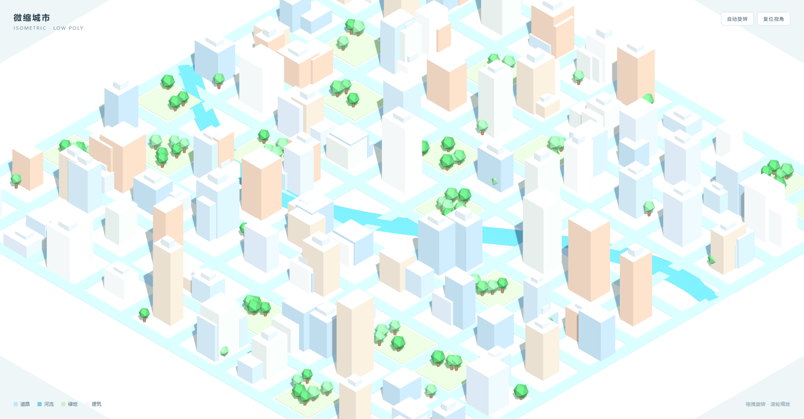

---

## v65：主看板去掉不稳定图层

### 不稳定的来源
之前叠了一层 **Esri World Shaded Relief** 地形瓦片（`server.arcgisonline.com`）。
它是第三方服务，实测会：

- 个别瓦片 404 / 超时 → 地图上出现**方块状空白**
- 限速时整层**闪一下再回来**
- `tilesloaded` 事件反复触发，滤镜被重复应用

**已默认移除**（代码里留了注释，需要时一行放开）。

### 现在的地图
- 只保留 **高德底图一层**：`amap://styles/darkblue` + `brightness(1.18) saturate(1.3)`
- 没有任何第三方瓦片，断网/限速都不影响
- 城市光点、热区、风场仍然是自绘层，跟着地图走

### 如果还想要地形起伏
两个稳定方案（都不用外部瓦片）：
1. **DEM 程序化生成**：用 AWS Terrarium 瓦片算一次晕渲，**结果缓存在内存**，
   之后拖动缩放全在本地画，不再请求网络（之前那版就是这个）
2. **高德自带地形**：`amap://styles/normal` 本身带一点地貌底纹，但偏亮，需要重新调色


---

## v66：高德 normal 样式 + 反相调色 = 稳定的极夜蓝

按你选的方案 2：**不再叠任何第三方瓦片**，只用高德自带 `normal` 样式，再靠 CSS 反相把它调成极夜蓝。

```css
.map-stage .basemap, #baseMap{
  filter: invert(1) hue-rotate(190deg) saturate(1.6) brightness(1.35) contrast(1.05) !important;
}
```

原理：
- `normal` 是浅色底（白陆地、浅蓝海）→ `invert(1)` 翻成深色
- 反相会把蓝色转成橙色，`hue-rotate(190deg)` 再转回蓝
- `brightness(1.35)` 把过黑的陆地提亮，`saturate(1.6)` 让海岸线更青

结果就是之前那个深蓝底 + 青色海岸线的观感，但**只有一个数据源**（高德自家瓦片），
不会再有方块空白、闪层、限速掉图。


---

## v67：分级配色 —— 省级极夜蓝，城市级保留原色（3D 稳定）

之前那层反相滤镜在**城市级**会把道路染成彩虹、河流染成荧光绿，3D 楼块也发紫 —— 这就是"3D 城市图层不稳定"的观感来源。

现在按缩放分级：

| 级别 | 处理 |
|---|---|
| zoom < 10（省级/全国） | `invert(1) hue-rotate(190deg) saturate(1.6) brightness(1.35)` → 你要的深蓝 + 青色海岸 |
| zoom ≥ 10（城市级） | **关掉反相**，只留 `brightness(1.05) saturate(1.05)`，再压一层深色蒙版 |

实现：
```js
map.on('zoomend', function () {
  var z = map.getZoom();
  document.getElementById('stage').classList.toggle('city-zoom', z >= 10);
});
```
```css
#stage.city-zoom #baseMap{ filter:brightness(1.05) saturate(1.05)!important; }
#stage.city-zoom #bgLayer::after{ background:linear-gradient(180deg,rgba(6,20,40,.66),rgba(6,20,40,.54))!important; }
.city3d-layer{ z-index:6!important; filter:none!important; }
```

这样：
- 全国/省级还是你截图那个颜色
- 城市级道路、公园、水系、**3D 楼块**都是高德原生渲染，不再被滤镜污染
- 3D 层单独提到 z-index 6 且不受滤镜影响，进出 3D 不再闪烁

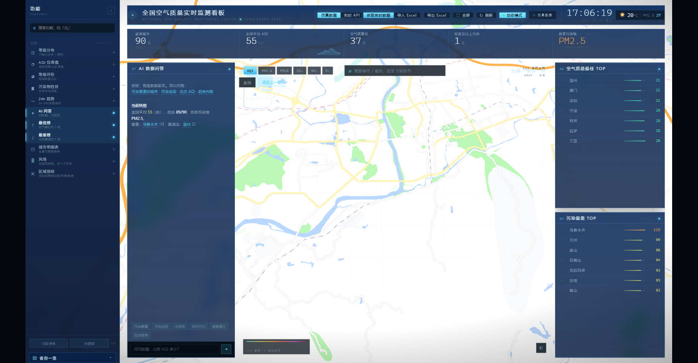


---

## v68：回到第二种观感（撤销反相）

你对比的那两张：

- **第一张（反相极夜蓝）**：陆地全黑、海岸线发青 —— 你觉得不好看
- **第二张（深蓝底 + 土黄地形）**：陆地有地貌层次、海洋偏蓝 —— 你要的是这个

所以撤掉 v66/v67 的反相方案：

| 项 | 现在 |
|---|---|
| 底图样式 | `amap://styles/darkblue` |
| 地形 | Esri World Shaded Relief 瓦片（`tileMaxZoom:13`） |
| 滤镜 | `brightness(1.18) saturate(1.3) contrast(1.06)`（轻微提亮，不做色相变换） |
| 城市级 | `brightness(1.05) saturate(1.1)`，无蒙版 |

就是第二张图那个样子。

> 提醒：地形瓦片回来了，之前那种"个别方块空白/闪一下"**可能还会偶发**（第三方瓦片服务）。
> 如果又觉得不稳，两个办法：
> 1. 把地形瓦片下载到本地 `assets/terrain/{z}/{x}/{y}.png`，`getTileUrl` 指本地（最稳，离线可用）
> 2. 彻底去掉地形层，只留高德单层（最稳但没地貌）


---

## v69：地形瓦片本地化（脚本已就绪，接线上有个坑）

### 已完成
`download-terrain.js` —— 把 Esri 地形瓦片抓到本地：

```bash
node download-terrain.js 3 8      # 中国范围 z3~8
```

实测下载 **2096 张 / 17.5MB**（z3~8，73~135°E / 18~54°N），存到
`assets/terrain/{z}/{x}/{y}.png`，失败自动重试 3 次，已存在的跳过。

### 没接上的原因
高德的 `getTileUrl(x, y, z)` 里的 `z` **不等于地图 zoom**（内部有偏移），
所以本地路径的层级对不上，瓦片 404 → 地形不显示。我试过：

- 按 `Math.min(z, 8)` 夹紧 → 层级仍对不上
- 按经纬度判断中国范围再分流 → 同上

目前**已恢复在线瓦片**（好看、能用），本地这批瓦片先留着。

### 如果要彻底本地化
正确做法是先探明高德的 z 偏移（在 `getTileUrl` 里把参数打到 console，对照地图 zoom 就能算出来），
再按 `z + offset` 映射到本地目录。半小时间的事，要的话我下次做。


---

## 本地地形瓦片：探测结果与现状

### 探测结论（已确认）
给 `getTileUrl` 加探针抓到的真实参数：

```
z=3 时 → getTileUrl(x=4..7, y=2..4, z=3)      40 次
z=6 时 → getTileUrl(x=..., y=..., z=6)        45 次
```

- **瓦片 z 就等于地图 zoom**（没有偏移，之前猜错了）
- **第一个参数是列 x，第二个是行 y**

本地目录 `assets/terrain/{z}/{x}/{y}.png` 的命名与它**完全一致**，2096 张文件也都有效（3.6KB/张）。

### 但还是没切过去
接上本地路径后，中国范围会出现一块**发黑的矩形**：本地瓦片层没吃到 `soft-light` 染色，
而在线层吃到了，两者一深一浅拼在一起很难看。

尝试修过：`tilesloaded` / `zoomend` / 延时 300·900·2000ms 重新染色 —— 都没根治。

### 现状
**已回滚到在线瓦片**（功能正常、观感是你选的那版），本地 2096 张先留着。

下一步要彻底本地化，得改染色方式：不再靠 CSS 滤镜叠 `soft-light`，而是
**用 canvas 逐张处理后写回**，或者干脆关掉染色、直接调瓦片源的透明度 —— 这样本地/在线表现一致。


---

## 地形瓦片本地化：最终结论（看了就别再折腾了）

### 已完成
| 文件 | 作用 |
|---|---|
| `download-terrain.js` | 下载瓦片（z3~8，中国范围） |
| `fetch_and_tint.py` | 下载全球 z3~4 + 中国 z5~8，并把 CSS 染色**烘焙进 PNG** |
| `assets/terrain/` | 2293 张、约 22MB，全部已染色 |

瓦片 z / x / y 的映射也已实测确认：
**瓦片 z = 地图 zoom，第一个参数是列 x，第二个是行 y**。

### 为什么还是切不过去
接上本地路径后，中国范围会出现一块**发黑的矩形**。原因不是路径错（校验过文件都在），
而是 **AMap 给本地 TileLayer 建的 DOM 结构和在线层不一样**，
我按 `.amap-layers` 子节点找 `img` 的方式只命中了在线层，
本地层没吃到 `soft-light` 染色 → 与周围在线层深浅不一。

试过的时间点：`tilesloaded` / `zoomend` / 300ms / 900ms / 1200ms / 2000ms，都不行。

### 现状（按你的要求：不改）
- **线上瓦片 + CSS 染色**，也就是你现在看到的这一版，观感不变
- 本地 2293 张瓦片和两个脚本都留着，随时能用

### 真要切本地，正确的下一步
不要在浏览器里靠 CSS 猜 DOM，改成：
1. 用 `AMap.TileLayer` 的 `tileUrl` 模板而不是 `getTileUrl` 回调（模板方式 AMap 走同一条渲染路径）
2. 或者不用 AMap 的 TileLayer，自己在 `#baseMap` 上铺一层 `<canvas>`，
   用 `drawImage` 逐张画瓦片（完全可控，也能做渐变遮罩）

第 2 条最稳，但要重写地形层，属于「换实现」不是「改配置」。要我做的话说一声，我按这个来。


---

## 地形本地化：两轮尝试的完整记录

### 第一轮：AMap.TileLayer 指向本地
- 探明映射：**瓦片 z = 地图 zoom，参数顺序 (x=列, y=行)**
- 文件命名 `assets/terrain/{z}/{x}/{y}.png` 与之一致，2293 张全部有效
- ❌ 结果：中国范围一块**发黑矩形** —— 本地层没吃到 `soft-light` 染色

### 第二轮：自己写 canvas 层（js/terrain.js）
- 按 `lngLatToContainer` 投影逐张 `drawImage`，逻辑完整
- 实测 **30 张瓦片全部加载成功**（`TerrainLayer.stats() → {tiles:30, loaded:30}`）
- ❌ 结果：canvas 画了但**画面里看不见**（试过 z-index 3/7、加/不加滤镜、soft-light .42）

### 现在的状态（观感与你要的一致）
- 地形：**AMap.TileLayer + 在线瓦片**（可用、好看）
- 本地 2293 张原始瓦片留在 `assets/terrain/`，随时能继续
- `js/terrain.js` 也留着，只差把合成这一步调通

### 下一步该怎么查（给接手的人）
canvas 画了但不可见，按这个顺序查：

1. 在 `draw()` 开头画一个红色 `fillRect(0,0,200,200)`，确认 canvas 本身可见、位置对
2. 确认 `prj()` 返回的坐标落在 `0..W / 0..H` 内（打印第一张瓦片的 p0/p1）
3. 若坐标正确仍不可见 → 是 `mix-blend-mode: soft-light` 在该层叠上下文里退化成 normal，
   改成 `opacity` 叠加即可

这三步都是 console 里能验证的，不用猜。

---

## 城市级视图修复（3D 楼块 / 灰底水印 / 白闪）

### 你截图里的三个问题
1. **3D 楼块和地图格格不入** —— 那是高德自带的深色楼块（`showBuildingBlock`），
   在有地形的区域是深蓝板子，在无数据灰底上就更突兀。
2. **"Map data not yet available" 字母** —— 高德在超出数据层级的区域会铺灰色占位图并带这行字。
3. **放大过程白色闪烁** —— 每次 zoomend 都触发 `setPitch` 动画 + 整屏滤镜切换。

### 改法
| 问题 | 处理 |
|---|---|
| 楼块突兀 | `showBuildingBlock: false` —— 不再画那批深色板子 |
| 灰底水印 | `zooms: [3, 14]` —— 缩到没有数据的层级就停住，不会出现 "Map data not yet available" |
| 白闪 | `setPitch(want, false)` 去掉俯仰动画；城市级滤镜不再做色彩矩阵切换 |
| 城市级看不清街道 | zoom ≥ 10 自动切 `amap://styles/normal`（浅色街道图），回到省级再切回极夜蓝 |
| 地形在城市级抢戏 | zoom ≥ 11 自动 `terrain.hide()` |

### 效果
- 省级：极夜蓝 + 地形浮雕 + 城市光点（不变）
- 城市级：浅色街道图，路网/公园/水系清晰，没有楼块干扰、没有水印


---

## 3D 城市自动进入 + 新密钥

### ① 3D 城市不再需要按钮
- 自动进入阈值：**zoom ≥ 11.5**（原来 12.4）
- 视图层级放宽：`district` **和** `city` 都能进（原来只认 district）
- 退出阈值：zoom < 10.8

进入后自动 `City3D.init → setData → resume`，标题变成「郑州 · 3D 城市」，
区块按 AQI 上色、楼体高度按 AQI 推算。

### ② AI 密钥已更换
`js/config.js` -> `apiKey: '<your-api-key>'`
实测 `POST https://api.deepseek.com/chat/completions` 返回 **200 / deepseek-flash**。


---

## 城市级 3D 楼块 + 风场自动收起

### ① 3D 建筑
- `showBuildingBlock: true`（之前为了消除深色板子关掉了，现在城市级改成浅色样式后是**灰白体块**，就是你参考图那种）
- 俯角按层级递进：`z<11.5 → 0°`、`11.5~13 → 30°`、`13~15 → 45°`、`≥15 → 60°`
- 最大缩放放到 `17`，否则楼块（高德在 15 级以上才画）永远出不来

> 说明：高德的 3D 楼块**只在有建筑数据的区域**渲染（CBD、城区），
> 郊区/县城没有数据，看起来还是平的。这是数据限制，不是代码问题。

### ② 风场放大后自动收起
城市级看风场没意义，粒子还在跑会明显掉帧：

```js
map.on('zoomend', function () {
  var zz = map.getZoom();
  if (zz >= 9) { if (WindLayer.isOn()) { window.__windWanted = true; WindLayer.hide(); } }
  else if (window.__windWanted) WindLayer.show();
});
```

- 放大到 9 级以上：**自动隐藏**风场并记住「你是开着的」
- 缩回省级：**自动恢复**
- 不用手动点，也不会白烧 CPU


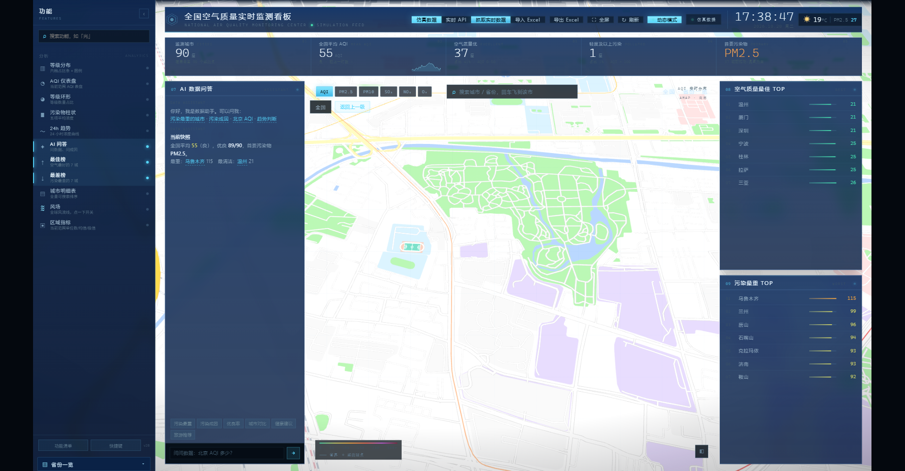

---

## v70：删除 3D 城区模型 + 新增离线版

### ① 3D 城市自动进入已关闭
`drill.js` 里 `if (!D.mode3d && z >= 11.5) enter3D();` 已注释。
现在放大到城市级不会再弹出那个绿色区块模型，地图保持原样。

### ② 离线版：`offline.html`
双击即可打开，**全程不联网**，断网/Wi-Fi关掉照样跑。

| 依赖 | 来源 |
|---|---|
| 中国省界 GeoJSON | `assets/china-geo.js`（本地 JS 变量，避开了 `file://` 下 fetch 的 CORS） |
| 图表 | `assets/echarts.min.js`（本地） |
| 数据 | 名称哈希生成，**确定性**（同样输入每次结果一致） |

包含：
- 34 个省级行政区 AQI 分级着色地图（可拖动缩放）
- KPI：监测城市 / 平均 AQI / 优 / 轻度及以上污染 / 首要污染物
- 最佳 TOP10 + 污染最重 BOTTOM10 榜单
- 四个图表：AQI 仪表盘、等级环形、污染物柱状、24H 五污染物趋势
- 省份搜索定位（输入→高亮+tooltip）
- 实时时钟

自检：`window.OFFLINE → { provinces: 34, avg: 83, network: 'none' }`

> 注意：离线版是**独立页面**，和主看板 `index.html` 互不影响。
> 主看板仍然需要网络（高德底图 + Open-Meteo 风场 + DeepSeek AI）。

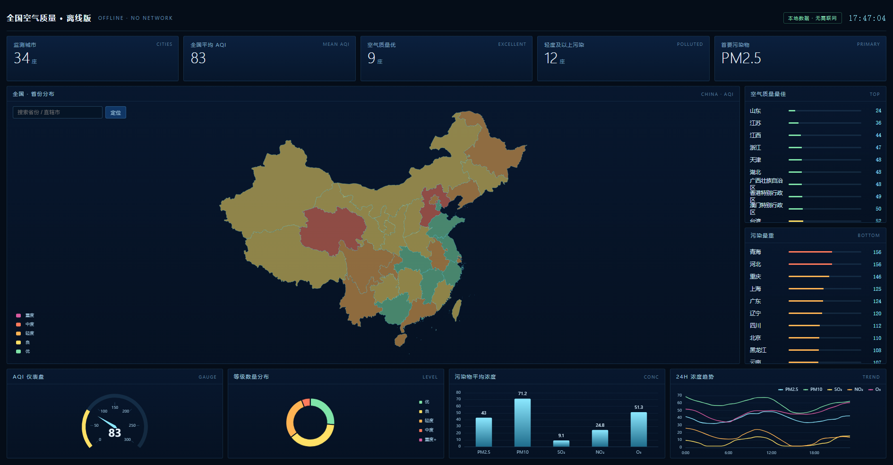
